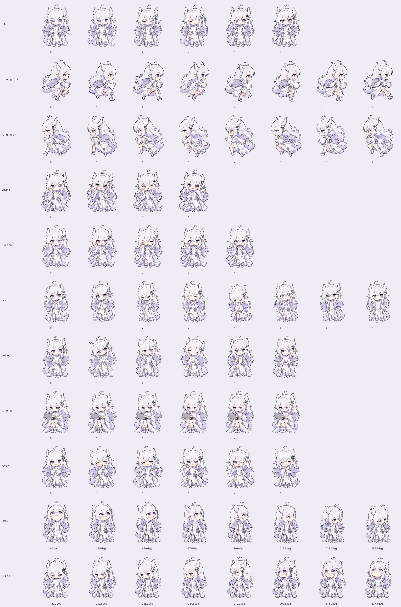

# GPT Girl · A Codex/ChatGPT Pet

[简体中文](README.md) · **English**

A little dragon girl with white hair and violet eyes, here to work, wait, and celebrate with you. This community-made **v2 custom pet pack** uses a lossless WebP sprite sheet with transparency. No API key is required.

The project draws inspiration from the community's DeepSeek whale girl character and the related `dsh-pet` plugin. Reference artwork comes from Bilibili creators @ZipZipPipe and @这个刀子真甜.

Who wouldn't want to adopt a little dragon girl?

## Preview

| Idle: breathing and blinking | Working: typing | Hover: smiling and waving | Done: clapping and giving a thumbs-up |
| :---: | :---: | :---: | :---: |
|  |  |  |  |

If the WebP animations don't play on GitHub, download the project and open `preview.html` for an interactive demo.

<details>
<summary>See every animation and all 16 viewing directions</summary>



</details>

## Installation

This pack is for desktop versions of Codex that support local v2 pets. The format was checked against Windows app version 26.930.2377.0. Behavior may change in later app versions.

### Windows: install with PowerShell

1. Download `gpt-pet-v1.0.0.zip` from this repository's **Releases** page and extract it. You can also download and extract the repository's source ZIP.
2. Open PowerShell in the extracted folder and run:

   ```powershell
   .\install.ps1
   ```

3. In the app's **Pets** settings, select **GPT娘**. In older versions, this may be under **Appearance**. If the pet is missing, refresh the list or restart the app. See the [official pet settings guide](https://learn.chatgpt.com/docs/reference/settings#pets).

If Windows blocks the script because it was downloaded, review the script, run `Unblock-File .\install.ps1`, then try again. If your organization blocks scripts, use the manual installation steps below.

The installer uses `$HOME/.codex/pets/gpt-pet/` by default, or `$CODEX_HOME/pets/gpt-pet/` if `CODEX_HOME` is set. It backs up an existing pet with the same name to `pet-backups/` under the Codex data directory and verifies each file after copying. Administrator privileges are not required.

To use a custom data directory:

```powershell
.\install.ps1 -CodexHome 'D:\CodexData'
```

### Manual installation

Create `pets/gpt-pet/` in your Codex data directory and copy these two files into it:

```text
pets/gpt-pet/
├── pet.json
└── spritesheet.webp
```

The default data directory is `%USERPROFILE%\.codex` on Windows and `~/.codex` on macOS/Linux. If `CODEX_HOME` is set, use that directory instead. Manual installation applies to apps that support the same v2 format. Platforms other than Windows were not tested in the app.

Back up the existing `gpt-pet` directory before upgrading. To uninstall, switch to a different pet first, then delete the `gpt-pet` installation directory.

## Animations

| State | Animation |
| --- | --- |
| idle | Smiles, breathes, blinks, and gently sways her tail |
| running-right / running-left | Runs in either direction, with separately drawn frames that keep the hair accessory on the correct side |
| waving | Waves, blushes, and blinks in greeting |
| jumping | Smiles and waves on hover, with both feet on the ground |
| failed | Looks worried, lowers her head, then rallies for another try |
| waiting | Tilts her head and gestures while waiting for a response |
| running | Types on a slim laptop |
| review | Claps, gives a thumbs-up, and blinks in celebration |
| look | Follows the pointer in 16 directions, spaced 22.5° apart |

`jumping` is the animation slot required by the app; this pack uses a standing wave for that slot. In the tested app version, both command execution and model activity use `running`. When pointer tracking is enabled, directional frames may take precedence over some animations. The app decides which events trigger each state.

The sprite sheet is **1536 × 2288** pixels, with 8 columns and 11 rows of 192 × 208 cells. It contains 73 animation frames and 15 empty transparent cells.

### Offline preview

Open `preview.html` to switch between nine states, hover to wave, drag to run, and try pointer tracking in 16 directions. A light background and slow playback are also available. The preview runs locally and does not receive live task events from the app.

### Image sharpness and frame timing

In the tested Windows app version (26.930.2377.0), the v2 loader requires a **1536 × 2288** sprite sheet, and the renderer reads an **8 × 11** grid of **192 × 208** cells. The `running` state uses the first **6 frames** of row index 7 (the eighth row). The first five frames last 120 ms each and the last frame lasts 220 ms, for a total of 820 ms.

Enlarging the pet beyond its native resolution can make it look soft. You can adjust its size in Codex under the settings for Mini and pets.

## License and artwork

The [MIT License](LICENSE) covers the code, documentation, sprite sheet, and preview assets provided in this repository. The character assets were created with AI image generation based on the original character design. This release does not include the original reference images, other example characters, generation prompts, or official app code. This project is unaffiliated with OpenAI. Product names and trademarks belong to their respective owners.
