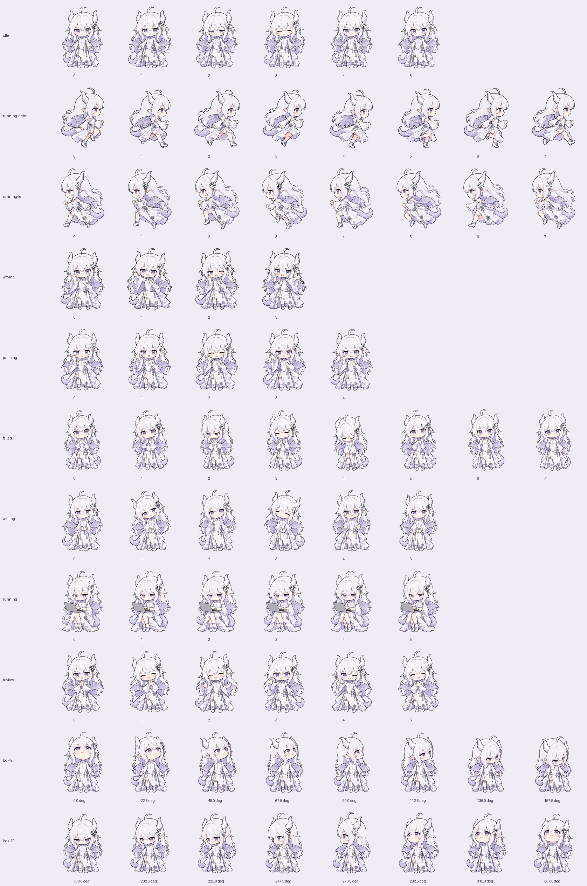

# GPT娘 · Codex/ChatGPT 宠物

白发、紫瞳的小龙娘，陪你工作、等待和庆祝。一个社区制作的 **v2 自定义宠物资源包**，使用无损透明 WebP 图集，不需要 API Key。


本项目灵感来自网络社区的DeepSeek鲸鱼娘形象以及其衍生的dsh-pet相关插件创作，素材图片来源于bilibili的社区创作者@ZipZipPipe和@这个刀子真甜

## 效果展示

| 待机：呼吸与眨眼 | 工作：连续敲键盘 | 悬停：微笑招手 | 完成：拍手点赞 |
| :---: | :---: | :---: | :---: |
|  |  |  |  |

GitHub 页面若未播放 WebP 动画，可以下载项目并双击 `preview.html` 查看交互演示。

<details>
<summary>查看所有动作与 16 个视角</summary>



</details>

## 安装方法

适用于支持本地 v2 宠物的 Codex 桌面版。格式以 Windows 应用 26.930.2377.0 的本地适配记录为依据；宿主更新可能改变行为。

### Windows：脚本安装

1. 从本仓库 **Releases** 下载 `gpt-pet-v1.0.0.zip` 并解压；也可以下载仓库源码 ZIP。
2. 在解压后的目录打开 PowerShell，执行：

   ```powershell
   .\install.ps1
   ```

3. 在应用设置的 **Pets / 宠物** 中选择 **GPT娘**。旧版本入口可能位于 **Appearance / 外观**；未出现时刷新列表或重启应用。[官方宠物设置说明](https://learn.chatgpt.com/docs/reference/settings#pets)

如果 Windows 提示脚本被下载标记阻止，检查脚本内容后可以执行 `Unblock-File .\install.ps1`，再重新运行。若组织策略禁止脚本，使用下面的手动安装方式。

脚本默认安装到 `$HOME/.codex/pets/gpt-pet/`；如果设置了 `CODEX_HOME`，则使用 `$CODEX_HOME/pets/gpt-pet/`。已有同名宠物会先备份到 Codex 数据目录的 `pet-backups/`，完成后逐文件校验复制结果。不需要管理员权限。

使用自定义数据目录：

```powershell
.\install.ps1 -CodexHome 'D:\CodexData'
```

### 手动安装

在你的 Codex 数据目录下创建 `pets/gpt-pet/`，将以下两个文件放入其中：

```text
pets/gpt-pet/
├── pet.json
└── spritesheet.webp
```

默认数据目录在 Windows 为 `%USERPROFILE%\.codex`，macOS/Linux 为 `~/.codex`。设置了 `CODEX_HOME` 时使用该路径。手动方式可用于支持相同 v2 加载格式的宿主，其他平台未做实际应用验证。

升级时先备份同名目录。卸载时先切换到其他宠物，再删除该 `gpt-pet` 安装目录即可。

## 功能说明

| 状态 | 动作 |
| --- | --- |
| idle | 微笑、呼吸、眨眼、尾巴轻摆 |
| running-right / running-left | 左右奔跑，独立画面保留发饰方向 |
| waving | 挥手、脸红、眨眼打招呼 |
| jumping | 悬停时站立微笑招手，双脚落地 |
| failed | 担心、低头、鼓劲重试 |
| waiting | 歪头、询问手势、等待回应 |
| running | 抱着轻薄本连续敲键盘 |
| review | 拍手、点赞、眨眼庆祝 |
| look | 16 个鼠标跟随视角，每隔 22.5° 一格 |

`jumping` 是宿主要求的槽位名称，本包画面为站立招手。当前适配的宿主将命令执行与模型思考共同映射到 `running`。开启鼠标跟随时，部分状态可能由方向画面覆盖；具体事件映射由宿主决定。

图集尺寸 **1536 × 2288**，8 列 × 11 行，每格 192 × 208，共 73 个有效帧和 15 个透明空格。

### 离线预览

双击 `preview.html`，可切换九种状态、悬停招手、拖动奔跑、开启 16 方向鼠标跟随，也可切换浅色背景和慢速播放。预览完全在本地运行，未接入真实任务事件。

### 清晰度与帧数

核对的OpenAI官方pet应用版本为 26.930.2377.0。

加载器要求 v2 图集尺寸严格为 **1536 × 2288**，渲染器按 **8 × 11** 格读取，每格 **192 × 208**。running 固定读取第 7 行前 **6 帧**，前五帧各 120 ms，最后一帧 220 ms，总计 820 ms。

原生尺寸会导致pet放大后出现低像素以及较模糊的情况，可手动在Codex中调整设置-Mini与虚拟宠物的自定义尺寸至您认为合适的大小。


## 许可证与素材说明

采用 [MIT License](LICENSE)，覆盖本仓库代码、文档及项目提供的宠物图集和展示素材。角色素材根据原项目设定，使用 AI 图像生成工具制作。本发布版本未包含原始参考图、其他示例角色、生成提示词或官方应用代码。项目与 OpenAI 无隶属关系，相关产品名称与商标属于各自权利人。
